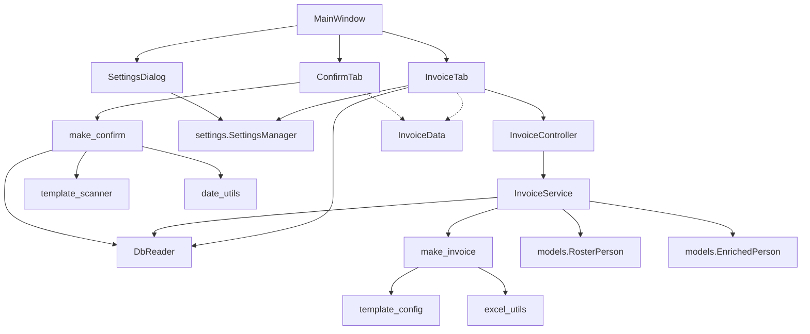
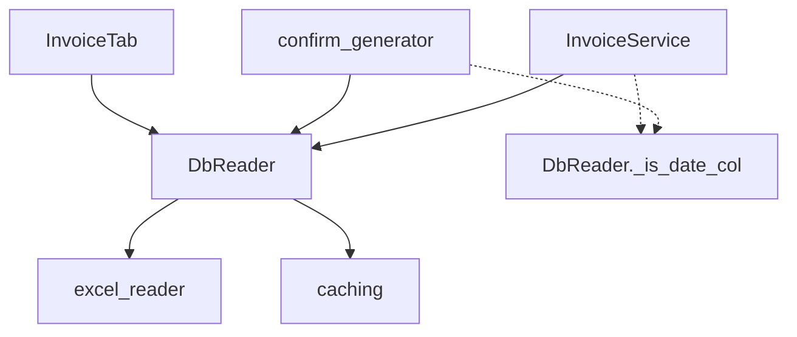
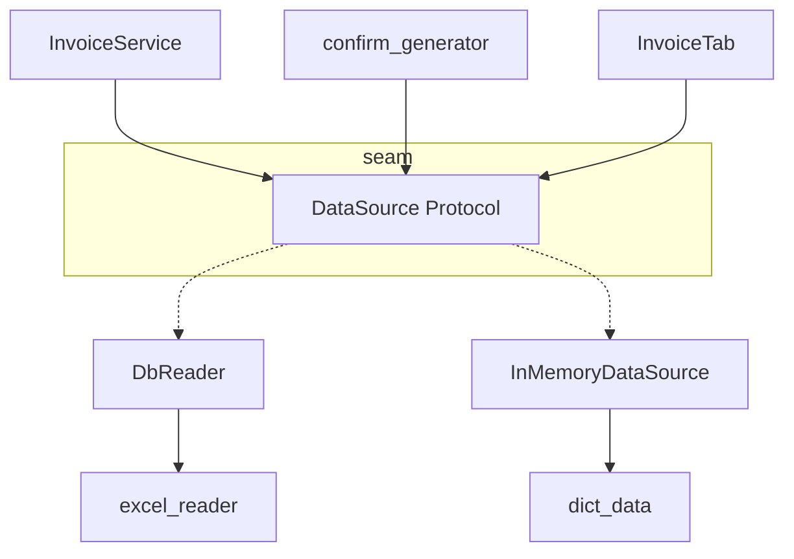
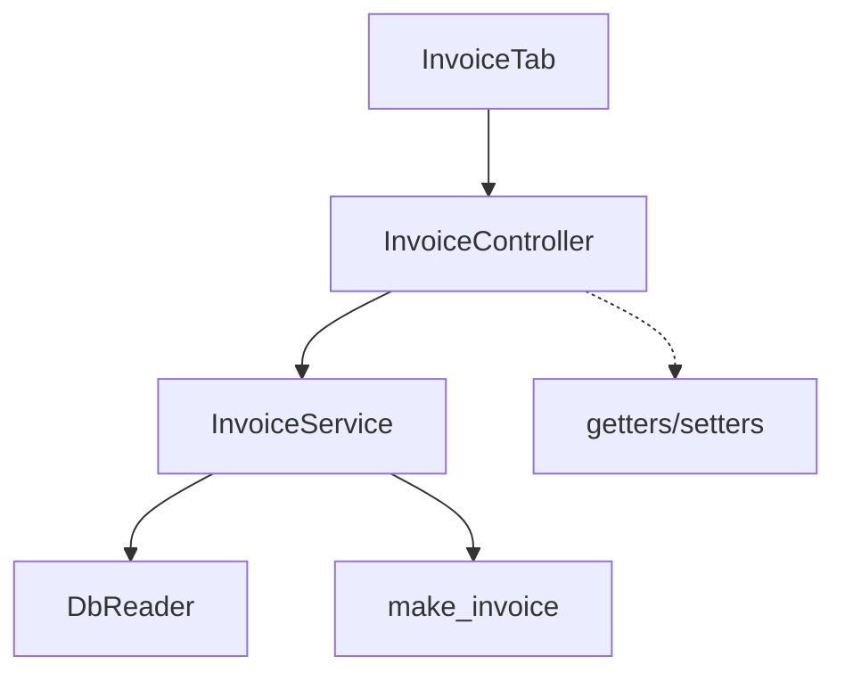
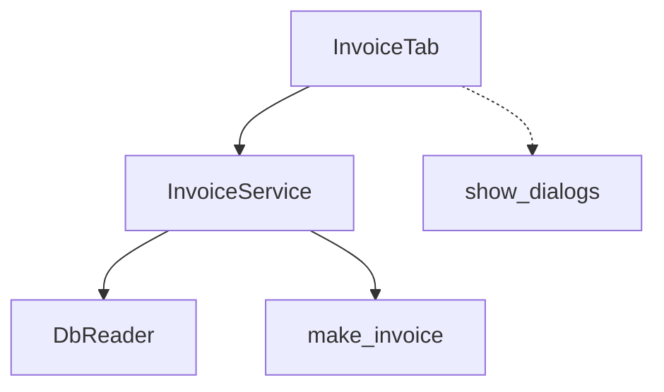
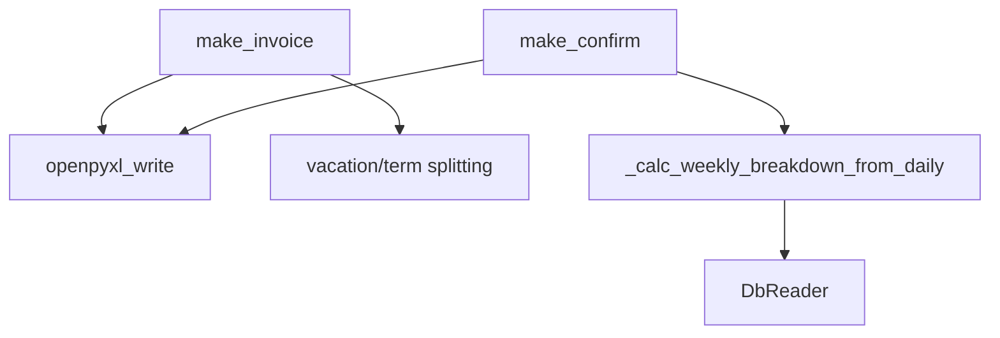
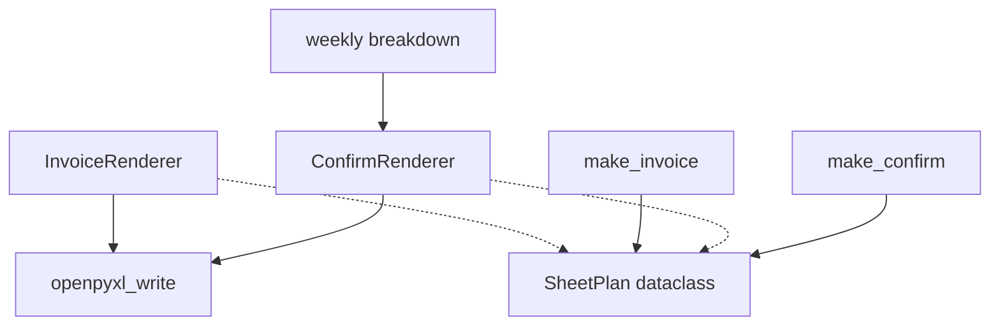

# Architecture Review: 급식비 정산 프로그램

**Date:** 2026-06-23
**Scope:** Full codebase (`src/`, `tests/`)

## Dependency Overview



---

## Candidate 1: DbReader — God class with no seam

- **Files:** `src/excel/db_reader.py`
- **Problem:** DbReader is a single class with ~20 public methods covering 7+ Excel sheets, caching, context-manager lifecycle, and ad-hoc mapping builders (`build_delivery_map`, `build_order_map`). Three different consumers (`InvoiceService`, `confirm_generator`, `InvoiceTab`) import it directly. There is no abstract interface — every test that touches data must either mock `get_db_reader()` (fragile) or read real Excel files (slow, environment-dependent). The low-level `_is_date_col` helper is even imported directly by `confirm_generator` and `InvoiceService`, leaking implementation detail across module boundaries.
- **Solution:** Define a `DataSource` protocol/ABC with only the methods consumers need (`read_roster`, `read_delivery_matrix`, `build_order_map`, `get_holiday_set`, `detect_month`, etc.). Let `DbReader` become one adapter implementing it. Introduce a second adapter (e.g. `InMemoryDataSource` or `DictDataSource`) for tests, proving the seam is real. Move private helpers (`_is_date_col`, `_to_date`, `_to_str`) inside the class or into a shared `_parsing` module — do not let them leak to consumers.
- **Benefits:**
  - **Locality:** Bug in data-source parsing affects only `DbReader`, not every consumer.
  - **Leverage:** A small `DataSource` interface replaces a 470-line import surface.
  - **Testability:** `InvoiceService` and `confirm_generator` can be tested without Excel files or fragile `patch`.
- **Recommendation Strength:** Strong
- **ADR Conflicts:** None

**Before Architecture:**



**After Architecture:**



---

## Candidate 2: InvoiceService.generate() — Parameter explosion (shallow interface)

- **Files:** `src/services/invoice_controller.py` (lines 50-65)
- **Problem:** `InvoiceService.generate()` takes **11 positional parameters**. The interface signature is nearly as complex as the implementation body. Callers must assemble all 11 values correctly, making the caller (InvoiceController) a pass-through that is itself hard to test. Adding a new parameter (e.g. `discount_rate`) would require touching every call site.
- **Solution:** Group related parameters into a dataclass. Specifically:
  - `InvoiceConfig` — year, month, breakfast_price, dinner_price, lunch_price, output_path, template_path
  - `RosterContext` — roster_data, col_mapping, roster_headers, template_columns, excluded_dates, db_path
  - Keep `InvoiceResult` as-is (it's already a dataclass — good).
  - Or, more radically, make `InvoiceService` a stateful object that receives config at construction time.
- **Benefits:**
  - **Leverage:** Interface shrinks from 11 args to 2 config objects.
  - **Testability:** Config objects can be constructed once in fixtures and reused.
  - **Locality:** New parameters are added to the config dataclass, not threaded through every call site.
- **Recommendation Strength:** Strong
- **ADR Conflicts:** None

**Before:**

```python
def generate(
    self,
    roster_data, output_path, year, month,
    breakfast_price, dinner_price, lunch_price,
    template_path, col_mapping, excluded_dates,
    roster_headers, template_columns, db_path=None,
) -> InvoiceResult:
```

**After:**

```python
@dataclass
class InvoiceGenerationConfig:
    roster_data: list[dict]
    template_path: str
    output_path: str
    year: int
    month: int
    breakfast_price: int = 9500
    dinner_price: int = 9500
    lunch_price: int = 9500
    col_mapping: dict = field(default_factory=dict)
    excluded_dates: set[date] = field(default_factory=set)
    roster_headers: list[str] = field(default_factory=list)
    template_columns: list[str] = field(default_factory=list)
    db_path: str | None = None

class InvoiceService:
    def generate(self, config: InvoiceGenerationConfig) -> InvoiceResult:
```

---

## Candidate 3: Duplicated cache JSON serialization across both tabs

- **Files:** `src/widgets/invoice_tab.py` (`_cache_invoice_data`, `_load_cached_invoice_data`), `src/widgets/confirm_tab.py` (`_load_cached_invoice_data`)
- **Problem:** Both `InvoiceTab` and `ConfirmTab` implement near-identical JSON cache read/write for `InvoiceData`, duplicating serialization/deserialization logic. `InvoiceTab` writes the cache; `ConfirmTab` reads it (plus `InvoiceTab` reads it for UI state restoration). The cache path is hardcoded as `.invoice_data_cache.json` in the output directory. Three separate `import json` / `from datetime import date` blocks exist.
- **Solution:** Move cache serialization into `InvoiceData` itself (`.to_cache_dict()` / `.from_cache_dict()`) or into a standalone `InvoiceDataCache` module. Unify path logic. Eliminate the import duplication.
- **Benefits:**
  - **Locality:** Cache format changes in one place.
  - **Leverage:** Callers write `InvoiceDataCache.save(data, path)` instead of 20 lines of boilerplate.
- **Recommendation Strength:** Worth exploring
- **ADR Conflicts:** None

---

## Candidate 4: EnrichedPerson dict backwards-compatibility tax

- **Files:** `src/core/models.py` (lines 50-79)
- **Problem:** `EnrichedPerson` implements `__getitem__`, `get()`, and `__contains__` to behave like a `dict` for legacy downstream code. The mapping in `__getitem__` (lines 51-61) must be manually kept in sync with actual fields. `person_to_dict()` (line 82) duplicates the same mapping in a different form. This is a migration shim that creates a hidden coupling: adding a field to `EnrichedPerson` requires updating the shim, or callers silently get wrong values. The deletion test: if you remove `__getitem__`/`get`/`__contains__`, all three methods' complexity would scatter across ~10 call sites that still use dict-style access.
- **Solution:** Complete the migration: convert the remaining `list[dict]` pipelines to use `EnrichedPerson` directly. Introduce a `to_row()` method that returns the flat dict only at the final output boundary (Excel rendering). Remove `__getitem__`, `get()`, and `__contains__` from `EnrichedPerson`.
- **Benefits:**
  - **Locality:** Type-checking catches field name typos at compile time.
  - **Leverage:** Removing 30 lines of shim eliminates a class of bugs where `ep["_typo"]` silently returns `""`.
- **Recommendation Strength:** Worth exploring (requires closing the migration gap)
- **ADR Conflicts:** None

---

## Candidate 5: InvoiceController — thin wrapper syndrome

- **Files:** `src/services/invoice_controller.py` (lines 246-375)
- **Problem:** `InvoiceController` is labeled "UI-aware wrapper" but it is both too thin (most methods are one-line getters/setters) and too thick (it holds business state like `_col_mapping`, `_excluded_dates`, `_year`, `_month` and has column auto-detection logic in `_auto_map_columns`). The `generate()` method (lines 268-307) does almost nothing except delegate to `InvoiceService` and show dialogs — it's a pass-through. The deletion test: if you delete `InvoiceController`, its complexity would reappear partly in `InvoiceTab` (show dialogs) and partly in `InvoiceService` (state), confirming it's shallow.
- **Solution:** Merge necessary state (`col_mapping`, `excluded_dates`, `roster_headers`, `roster_path`, `year`, `month`) into a single config object held by `InvoiceTab`. Move the "show warning dialog" responsibility into `InvoiceTab` (where other UI logic already lives). Delete `InvoiceController`.
  - This is safe because no other module imports `InvoiceController`.
- **Benefits:**
  - **Locality:** All UI logic in one layer; all business logic in `InvoiceService`.
  - **Leverage:** Removing 129 lines of pass-through makes the remaining code easier to navigate.
- **Recommendation Strength:** Strong
- **ADR Conflicts:** None

**Before Architecture:**



**After Architecture:**



---

## Candidate 6: SettingsManager typed accessor explosion

- **Files:** `src/core/settings.py` (lines 205-298)
- **Problem:** `SettingsManager` has ~25 typed convenience accessors (`get_app_title`, `get_confirm_col_widths`, etc.). Each is ~3 lines of boilerplate. Adding a new config key requires: (1) default in `DEFAULTS`, (2) typed accessor, (3) `SettingsDialog` binding. The accessors provide no new abstraction — they just cast `self.get(...)`. The deletion test: if you remove all accessors and replace with direct `s.get("app", "title")` calls, no complexity is lost; it just moves to call sites (and some callers already use `s.get()` directly, confirming the accessors are not earning their keep).
- **Solution:** Replace typed accessors with a data-driven `config` namespace object, or just use `s.get()` directly at call sites. Reserve accessors only for logic beyond a simple get (e.g. `get_app_window_size()` returns a tuple — that one earns its keep).
- **Benefits:**
  - **Leverage:** ~80 lines of boilerplate removed.
  - **Locality:** Config key → default mapping lives in `DEFAULTS` only, not scattered across accessors.
- **Recommendation Strength:** Worth exploring
- **ADR Conflicts:** None

---

## Candidate 7: InvoiceGenerator / ConfirmGenerator — business logic mixed with template rendering

- **Files:** `src/generators/invoice_generator.py`, `src/generators/confirm_generator.py`
- **Problem:** Both generators mix domain calculation (e.g. `_calc_weekly_breakdown_from_daily` in `confirm_generator.py`, the sheet-splitting logic in `make_invoice` based on vacation/is_vacation_month) with openpyxl rendering code. This makes the business logic untestable without Excel files and makes the rendering hard to vary (e.g. switching from openpyxl to another library).
- **Solution:** Extract the computation into pure functions that return a "render plan" data structure (e.g. list of `SheetPlan` dataclasses). The rendering module then reads the plan and writes Excel. This creates a seam at the render boundary.
- **Benefits:**
  - **Testability:** `SheetPlan` generation can be unit-tested without Excel files.
  - **Locality:** A bug in rendering (e.g. wrong cell address) doesn't risk corrupting the computation.
- **Recommendation Strength:** Speculative (worth exploring if openpyxl coupling becomes painful)
- **ADR Conflicts:** None

**Before Architecture:**



**After Architecture:**



---

## Candidate 8: Missing integration/end-to-end tests

- **Files:** All test files in `tests/`
- **Problem:** The test suite has excellent unit coverage for domain models (`models`, `meal_types`, `date_utils`, `settings`) and partial coverage of `InvoiceService` (via mocked `DbReader`). But there are **zero tests** for:
  - `DbReader` (no test exercises real Excel reading)
  - `invoice_generator` / `confirm_generator` (no test verifies Excel output)
  - `template_scanner` (placeholder scanning is untested)
  - `excel_utils` (cell copy, merged cell handling)
  - Any widget (no PyQt test infrastructure)
  - The `InvoiceTab → InvoiceController → InvoiceService → make_invoice` end-to-end pipeline
- **Solution:** Add one "golden file" integration test that reads a fixture `db.xlsx`, generates an invoice, and asserts key cells in the output workbook. This catches regressions in the pipeline that unit tests (with mocks) cannot.
- **Benefits:**
  - **Locality:** Changes to column mapping, row offset, or formula generation are caught before deployment.
  - **Leverage:** One integration test covers the deepest part of the system.
- **Recommendation Strength:** Strong
- **ADR Conflicts:** None

---

## Summary

| Priority | Candidate | Effort | Impact | Risk |
|----------|-----------|--------|--------|------|
| P0 | #1 DbReader interface seam | 2-3 days | High — unlocks testability | Low |
| P0 | #2 Config object for InvoiceService | 0.5 day | Medium — reduces parameter surface | Low |
| P1 | #5 Delete InvoiceController | 1 day | Medium — removes pass-through | Low |
| P1 | #8 Integration tests | 1 day | High — catches pipeline bugs | Low |
| P2 | #3 Unified cache serialization | 0.5 day | Low — pure DRY | Low |
| P2 | #6 Collapse SettingsManager accessors | 0.5 day | Low — reduces boilerplate | Low |
| P3 | #4 Complete EnrichedPerson migration | 2 days | Medium — type safety | Medium |
| P3 | #7 Extract render plan from generators | 3-4 days | Medium — render flexibility | Medium |

**Quick wins (can be done in <1 day each):** #2, #5, #3, #6
**High-impact investments:** #1, #8
